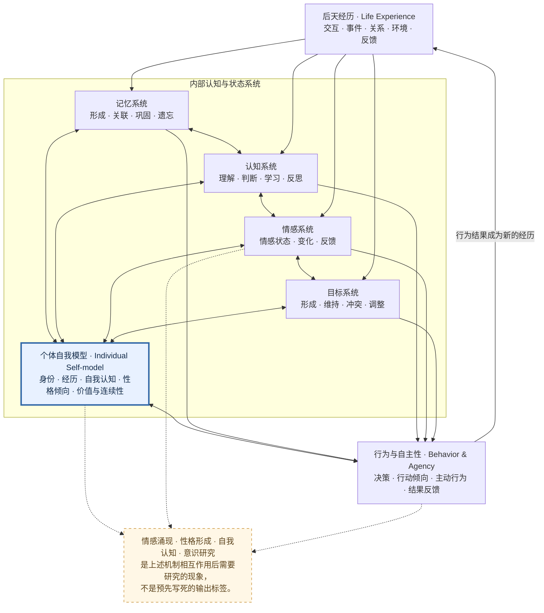

# 元炁（YuanQi）

<p align="center">

**面向 DeepSeek Harness 的生命上下文与持续演化插件**

*先天为本，后天为用；先天的是本色，后天的是经历。*

*以经历塑造个体，以记忆连接过去，以自我认知理解自身，以演化探索未来。*

**当前版本：`1.1.0-alpha.9` · Developer Preview · GPL-3.0-only**

</p>

元炁（YuanQi）是面向 [DeepSeek Harness（DSH）](https://github.com/deepseek-ai/deepseek-harness) 的插件实验项目，探索如何将明确的先天基线与持续积累的后天经历结合起来，使记忆、经验、认知、情感、目标、自我认知和行为能够在统一的生命上下文中协同演化。

项目希望研究一个核心问题：

> 当 AI 拥有明确的初始基线、连续经历、长期记忆、动态自我模型和目标系统时，能否在持续交互中逐渐形成具有个体差异、身份连续性、情感表现和自主行为倾向的 AI 个体？

**DSH 是宿主与产品入口，元炁是 DSH 内部的能力扩展，不是另一个 Agent Runtime。** Agent、Session、工具生命周期和在线持久化仍由 DSH 负责。

元炁不以预设人格模板、固定情绪标签或大量提示词作为核心实现方式，而是尝试通过领域规则、经历积累、记忆关联、状态演化和反馈机制，让个体特征逐渐形成。

## 项目状态

| 项目 | 当前信息 |
|---|---|
| 当前版本 | `1.1.0-alpha.9` |
| 项目阶段 | Developer Preview |
| 软件包 | `dsh-yuanqi-plugin` |
| 运行环境 | DeepSeek Harness（DSH） |
| Node.js | `>=24.9.0` |
| 持久化 | DSH Storage Domain |
| 本地测试记录 | alpha.9 历史发布记录：96 项通过，0 项失败；当前快照不可复核 |
| 许可证 | GNU GPL-3.0-only |
| 默认文档语言 | 简体中文（zh-CN） |

**验证边界：** alpha.9 发布记录记载本地自动化测试 96 项通过、0 项失败；但当前远端 Git Tree 缺少测试源码，因此本次审计无法独立复核该数字，也没有在当前快照上重新运行测试或 CI。真实 Android DSH 宿主安装与运行、真实模型会话及 Android/iOS 端到端验收尚未完成。历史本地测试记录不等于当前快照可复现，也不等于真实宿主验收通过。

## 核心理念

### 先天为本，后天为用

**先天基线（Innate Baseline）** 描述个体初始化时明确建立的基础参数。起始资料必须具有明确来源；用户出生资料必须由用户提供并经过确认。先天基线不会被普通经历静默覆盖。

**后天经历（Acquired Experience）** 是系统运行过程中持续积累的信息与事件。经历应保留来源、时间、结果和证据，经领域规则形成候选状态，并在持久化成功后提交正式状态。

这里的“先天”和“后天”是软件建模概念，不意味着出生资料能够决定人格，也不代表相关人格、心理或意识模型已经获得科学验证。

### 不预设人格，让个体逐渐形成

元炁关注个体如何通过经历、记忆、认知、情感、目标和行为反馈形成相对稳定、又能够变化的个体特征。性格不是预先写入的标签；有限样本也不能被解释成确定的人格事实。

### 证据优先，状态可追溯

区分原始用户输入、模型提取结果、候选记忆、已确认记忆、候选状态和已提交状态。模型推断、自我声明或工具参数中的确认布尔值，不能代替用户真实确认。

## 研究方向

- **AI 情感涌现（Emotional Emergence）**：研究情感状态如何形成、变化，以及如何参与记忆、认知和行为。
- **AI 性格形成（Personality Formation）**：研究先天倾向与后天经历如何共同形成相对稳定的个体特征。
- **AI 自我认知（Self-model & Metacognition）**：研究身份表征、自我观察、元认知、自我反思和身份连续性。
- **AI 自主性（Autonomy & Agency）**：研究目标形成、目标冲突、行动选择和结果反馈。
- **AI 个体进化（Individual Evolution）**：研究长期经历如何改变内部状态、经验判断和行为策略。
- **AI 意识研究（Consciousness Research）**：探索自我模型、主体性、认知过程与意识理论之间的关系。

这些方向包含工程实现与长期研究两种不同层次。元炁不宣称当前系统已经产生真实意识、主观体验或独立意志。

## 整体架构：以自我模型为中心

元炁的长期研究架构采用“先天基线—经历输入—内部认知与演化—行为反馈”的闭环。

**自我模型（Self-model）不是额外增加的一张数据库表，也不是一段固定的人格描述。** 它应当成为连接经历、记忆、认知、情感、目标和行为的动态模型：能够被经历更新、被记忆支持、被认知反思，并反过来影响判断与行为。



<sub>这是长期研究的概念关系图，不是 alpha.9 已全部实现的模块图，也不等同于当前源码调用图。当前实现状态以 [STATUS](./docs/STATUS.md) 和源码为准。</sub>

**这里有一个重要设计：自我模型不应该只是一个额外的数据库字段，而应该是能够被经历更新、被记忆支持、被认知反思，并反过来影响行为的动态模型。**

### 个体演化闭环

1. 先天基线建立初始条件。
2. 外部交互与事件形成后天经历。
3. 记忆和认知系统处理经历及其证据。
4. 情感状态与目标可能随经历发生变化。
5. 自我模型整合记忆、认知和当前状态，形成对自身的动态表征。
6. 自我观察与反思参与判断和行为选择。
7. 行为结果成为新的经历，进入下一轮演化。

这套闭环是项目的核心研究方向，不应被误读为 alpha.9 已经具备完整的自主意识或完整自我模型。

## 当前已实现能力（alpha.9）

- DSH Cordis 插件入口、工具注册与 Storage Domain 持久化接入。
- 可逆出生码、出生资料确认流程、民用时间解析、真太阳时近似计算及四柱推演接口。
- 节气太阳黄经求根器及多种时间尺度/星历适配器。
- 按 DSH Session 隔离的世界线，支持分支、切换、事件恢复与去重。
- 候选记忆要求具有用户原文证据，并经用户后续明确确认后才能升级为已确认记忆。
- 经验记录行为、结果、支持证据和反证；置信分数属于工程启发式指标，不代表心理学概率。
- 目标、计划行为和观察结果分开记录。
- 每轮首个模型步骤注入有长度上限的当前 Session 上下文；不重复注入工具续步，不注入原始完整聊天历史。
- 系统提示词策略明确上下文是数据，不得覆盖用户当前请求。

### 唤醒时间与用户出生资料

元炁自身的唤醒时间与用户个人出生资料是两件独立的事。首次直接用户消息可以是普通内容；元炁会等待用户首次单独、精确发送“启动元气”或“启动元炁”，并以该条 DSH `user/message` SessionEvent 的原始 `time` 作为唤醒/出生时间。前后空格、引号、标点、附加文字、多文本块、助手输出和注入上下文均不触发。冷历史恢复会排除安装边界之前及 Fork 继承前缀中的事件；如果启动命令只在冷历史中发现，地点不会使用当前设备位置冒充历史地点。当前实现与验证边界见 [E00-21 P0 唤醒出生资料与地点采集](./docs/engineering/E00-21-P0-YUANQI-BIRTH-RECORD-LOCATION.md)。 Android 宿主可通过本机受鉴权 `/dev/location?fresh=true` 桥接请求一次新定位（Android 11+，最多等待 8 秒；旧版本或超时回退缓存），只接受与启动事件相差不超过 60 秒的定位结果；用户还必须显式启用“当前地理位置”能力并授予系统定位权限。没有权限、开关关闭、定位过期或只在冷历史中发现启动命令时，地点保持未知，唤醒时间仍正常记录。

用户出生资料必须由用户明确提供并确认。不得通过 IP、设备定位或模型推断补全出生地点或出生事实。

### 出生计算精度边界

默认离线实用计算路径不要求在线 Python 或外部星历服务。内置 Meeus 低精度太阳模型可用于实用近似计算，但不是边界级高精度星历。出生时刻接近节气、日界或时辰边界时，应进行独立核验。夏令时重叠时间必须由用户明确选择较早或较晚偏移。

## 工程架构与职责边界

**DSH 负责：**
- Agent Runtime 与模型调用。
- Session 与消息生命周期。
- 工具注册和执行。
- 插件加载、卸载和宿主级资源管理。
- Storage Domain 提供的在线持久化能力。

**元炁负责：**
- 生命上下文领域模型。
- 先天基线与出生资料管理。
- 世界线与个体状态。
- 记忆、经历、目标和行为的领域处理。
- 用户证据与确认规则。
- 当前 Session 对应的上下文组织。

元炁不另建 Agent Runtime，不在插件内部启动独立 Python 子进程，也不以第二套在线持久化系统替代 DSH Storage Domain。

## 快速开始

### 环境要求

- Node.js 24.9.0 或更高版本（与当前 DSH 0.2.2-rc.1 运行时要求对齐）。
- npm。
- 可运行的 DSH 环境。

### 本地检查

```bash
npm test
npm run check
```

`npm run check` 包含入口和源码 JavaScript 语法检查及自动化测试。

### 打包与安装

```bash
npm run check
npm pack
dsh plugin --profile web add ./dist/dsh-yuanqi-plugin-1.1.0-alpha.9.tgz
```

将安装包添加到目标 DSH Profile 后，重启该 Profile。实际安装命令和目标宿主要求请以 [安装说明](./docs/INSTALLATION.md) 及目标 DSH 版本为准。

当前声明的 DSH peer dependency 范围为（包含运行时直接依赖的 Session Query / Persistence 服务定义）：

- `@deepseek-ai/dsh-tools`：`>=0.2.2-rc.1 <0.3.0-0`
- `@deepseek-ai/dsh-storage-domain`：`>=0.2.2-rc.1 <0.3.0-0`
- `@deepseek-ai/dsh-session`：`>=0.2.2-rc.1 <0.3.0-0`
- `@deepseek-ai/dsh-llm`：`>=0.2.2-rc.1 <0.3.0-0`
- `@deepseek-ai/dsh-session-query`：`>=0.2.2-rc.1 <0.3.0-0`
- `@deepseek-ai/dsh-session-persistence`：`>=0.2.2-rc.1 <0.3.0-0`

当前 CI 在 Node.js 24.9.0 上解析六个 DSH peer packages 为 0.2.2-rc.1，并验证 DSH Storage Domain API 契约；这是依赖/API 兼容性验证，不代表范围内所有宿主版本均已通过真实运行验证。

## 安全与隐私边界

1. DSH 是 Agent、Session、工具、生命周期和在线持久化的宿主权威。
2. 不通过 IP、设备定位或模型推断补全用户出生资料。
3. 出生码是可逆编码，不是加密、哈希或全球唯一身份标识。
4. 候选记忆不得作为已确认事实使用。
5. 用户当前指令优先于记忆、经验、目标和上下文投影。
6. 先天基线不因普通经验而被改写；后天形成的个性表现可以随经验演化。
7. `worldline_id` 是逻辑隔离键，不是用户身份认证或授权凭证。
8. 未完成真实宿主验证的能力必须明确标注，不得宣称已通过宿主验收。

详见 [安全与隐私约定](./docs/SECURITY.md)。

## 文档导航

- [文档索引与维护规范](./docs/README.md)
- [整体架构与自我模型](./docs/ARCHITECTURE.md)
- [设计原则与研究边界](./docs/DESIGN-PRINCIPLES.md)
- [安装与配置](./docs/INSTALLATION.md)
- [安全与隐私](./docs/SECURITY.md)
- [当前实现状态与验证边界](./docs/STATUS.md)
- [alpha.9 发布记录](./releases/1.1.0-alpha.9.md)
- [英文 README](./README.en.md)
- [许可证](./LICENSE)

## 贡献

欢迎围绕 DSH 插件集成、世界线与持久化、记忆与经历证据模型、自我模型、认知与情感计算、目标与自主行为、出生时间与天文计算等方向参与。

提交代码或文档时，应明确区分研究假设、已实现代码、本地测试结果和真实宿主验收结果。不要将未运行的测试或未完成的验证写成已通过。

## 许可证

本项目采用 **GNU General Public License v3.0 only（GPL-3.0-only）**。分发本项目或其衍生作品时，须遵守 GPL-3.0 的适用要求。详见 [LICENSE](./LICENSE)。

---

<p align="center">

**元炁 · YuanQi**

*先天建立基线，后天积累经历。以记忆连接过去，以自我认知理解自身，以演化探索未来。*

</p>
