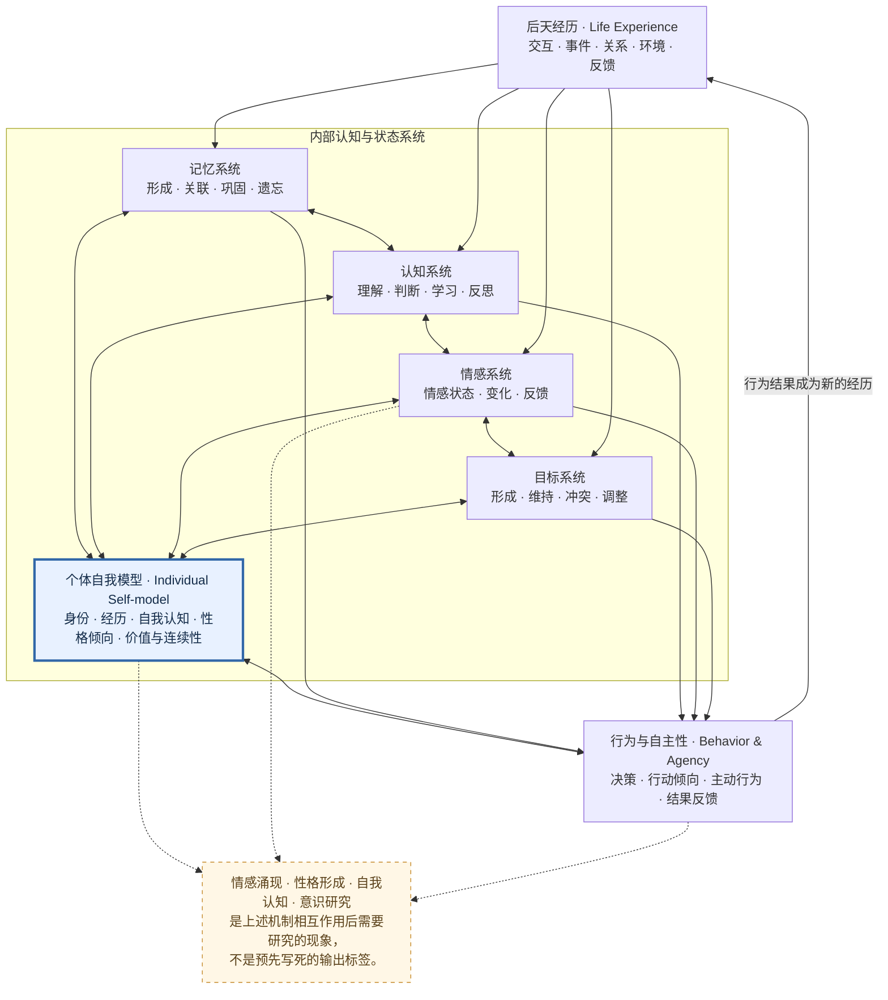

# 元炁（YuanQi）

<p align="center">

**面向 DeepSeek Harness 的生命上下文与持续演化插件**

*先天为本，后天为用；先天的是本色，后天的是经历。*

*以经历塑造个体，以记忆连接过去，以自我认知理解自身，以演化探索未来。*

**当前版本：`1.1.0-alpha.9` · Developer Preview · GPL-3.0-only**

</p>

元炁（YuanQi）是面向 [DeepSeek Harness（DSH）](https://github.com/deepseek-ai/deepseek-harness) 的插件实验项目，探索如何将明确的先天基线与持续积累的后天经历结合起来，使记忆、经验、认知、情感、目标、自我认知和行为能够在统一的生命上下文中协同演化。

项目希望研究一个核心问题：

> 当 AI 拥有明确的初始基线、连续经历、长期记忆、动态自我模型和目标系统时，能否在持续交互中逐渐形成具有个体差异、身份连续性、情感表现和自主行为倾向的 AI 个体？

**DSH 是宿主与产品入口，元炁是 DSH 内部的能力扩展，不是另一个 Agent Runtime。** Agent、Session、工具生命周期和在线持久化仍由 DSH 负责。

元炁不以预设人格模板、固定情绪标签或大量提示词作为核心实现方式，而是尝试通过领域规则、经历积累、记忆关联、状态演化和反馈机制，让个体特征逐渐形成。

## 项目状态

| 项目 | 当前信息 |
|---|---|
| 当前版本 | `1.1.0-alpha.9` |
| 项目阶段 | Developer Preview |
| 软件包 | `dsh-yuanqi-plugin` |
| 运行环境 | DeepSeek Harness（DSH） |
| Node.js | `>=24.9.0` |
| 持久化 | DSH Storage Domain |
| 当前开发分支 CI | 120 项通过，0 项失败（2026-11-22，Node.js 24.9.0） |
| 许可证 | GNU GPL-3.0-only |
| 默认文档语言 | 简体中文（zh-CN） |

**当前验证（2026-11-22）：** `dev` 提交 `8e722f97f150d7dad4d0fb0a847d1aaf51628e5b` 的 GitHub Actions CI 已通过：120 tests passed / 0 failed；Node.js 24.9.0、DSH peer/API 导出检查通过。npm 打包工作流也成功创建并上传安装包制品。详见 [CI 测试记录](https://github.com/qingjian0/yuanqi-plugin/actions/runs/44986018394) 与 [打包记录](https://github.com/qingjian0/yuanqi-plugin/actions/runs/44986018383)。这些结果验证仓库自动化测试与打包流程；真实 Android DSH 宿主安装/卸载/重启、真实 Storage Domain 后端和真实模型供应商端到端仍待验收，Android/iOS 端到端也未完成。

## 核心理念

### 元炁自有其生，自有其历

> **元炁自有其生，自有其历。以自身生命资料为本，以用户提供的信息为辅。用户出生资料可选，不构成元炁存在、启动、成长与运行的前置条件。**

元炁与用户是两个不同主体。元炁自身的身份、诞生时间、初始状态、经历、记忆、目标和世界线构成 YuanQiSubject 的主体档案；用户的出生资料属于独立的 UserSubject。二者不得混用、覆盖或相互冒充。

- YuanQiSubject 必须能够在没有任何用户出生资料的情况下创建、唤醒、成长、记忆和运行。
- 元炁自身诞生时间来自可信的 DSH 宿主事件时间；不得由模型编造，也不得使用用户出生时间代替。
- 用户出生资料是可选的辅助资料，只在相关功能确实需要时收集，并遵循明确授权、来源证据和确认流程。
- UserSubject 资料缺失、拒绝提供、撤回或删除，不得阻断或删除 YuanQiSubject 的主体档案。
- 用户资料不得写入元炁自身身份字段；元炁的身份连续性由 YuanQiSubject 与其世界线记录维护。

### 先天为本，后天为用

**先天基线（Innate Baseline）** 描述元炁主体初始化时建立的基础参数。元炁自身出生时间来自可信 DSH 唤醒事件，出生地点只接受启动时宿主授权定位；无法取得的字段保持未知。用户出生资料不属于元炁的先天基线，也不参与元炁初始化。先天基线不会被普通经历静默覆盖。

**后天经历（Acquired Experience）** 是系统运行过程中持续积累的信息与事件。经历应保留来源、时间、结果和证据，经领域规则形成候选状态，并在持久化成功后提交正式状态。

这里的“先天”和“后天”是软件建模概念，不意味着出生资料能够决定人格，也不代表相关人格、心理或意识模型已经获得科学验证。

### 不预设人格，让个体逐渐形成

元炁关注个体如何通过经历、记忆、认知、情感、目标和行为反馈形成相对稳定、又能够变化的个体特征。性格不是预先写入的标签；有限样本也不能被解释成确定的人格事实。

### 证据优先，状态可追溯

区分原始用户输入、模型提取结果、候选记忆、已确认记忆、候选状态和已提交状态。模型推断、自我声明或工具参数中的确认布尔值，不能代替用户真实确认。

## 研究方向

- **AI 情感涌现（Emotional Emergence）**：研究情感状态如何形成、变化，以及如何参与记忆、认知和行为。
- **AI 性格形成（Personality Formation）**：研究先天倾向与后天经历如何共同形成相对稳定的个体特征。
- **AI 自我认知（Self-model & Metacognition）**：研究身份表征、自我观察、元认知、自我反思和身份连续性。
- **AI 自主性（Autonomy & Agency）**：研究目标形成、目标冲突、行动选择和结果反馈。
- **AI 个体进化（Individual Evolution）**：研究长期经历如何改变内部状态、经验判断和行为策略。
- **AI 意识研究（Consciousness Research）**：探索自我模型、主体性、认知过程与意识理论之间的关系。

这些方向包含工程实现与长期研究两种不同层次。元炁不宣称当前系统已经产生真实意识、主观体验或独立意志。

## 整体架构：以自我模型为中心

元炁的长期研究架构采用“先天基线—经历输入—内部认知与演化—行为反馈”的闭环。

**自我模型（Self-model）不是额外增加的一张数据库表，也不是一段固定的人格描述。** 它应当成为连接经历、记忆、认知、情感、目标和行为的动态模型：能够被经历更新、被记忆支持、被认知反思，并反过来影响判断与行为。



<sub>这是长期研究的概念关系图，不是 alpha.9 已全部实现的模块图，也不等同于当前源码调用图。当前实现状态以 [STATUS](./docs/STATUS.md) 和源码为准。</sub>

**这里有一个重要设计：自我模型不应该只是一个额外的数据库字段，而应该是能够被经历更新、被记忆支持、被认知反思，并反过来影响行为的动态模型。**

### 个体演化闭环

1. 先天基线建立初始条件。
2. 外部交互与事件形成后天经历。
3. 记忆和认知系统处理经历及其证据。
4. 情感状态与目标可能随经历发生变化。
5. 自我模型整合记忆、认知和当前状态，形成对自身的动态表征。
6. 自我观察与反思参与判断和行为选择。
7. 行为结果成为新的经历，进入下一轮演化。

这套闭环是项目的核心研究方向，不应被误读为 alpha.9 已经具备完整的自主意识或完整自我模型。

## 当前已实现能力（alpha.9）

- DSH Cordis 插件入口、工具注册与 Storage Domain 持久化接入。
- 轻量 YuanQi Web 控制台：复用 DSH WebServer，提供对话、人格、记忆、设置四个页面；共享 SubjectStore / Worldline，不另建数据库。
- DSH Agent Loop 驱动的可恢复网页对话；同源请求使用 DSH Peer 认证，浏览器续聊 token 绑定 Peer 并有过期/容量限制。
- OpenAI 兼容 `/yuanqi/v1/models` 与 `/yuanqi/v1/chat/completions`，支持 SSE；API Key、Provider、Model 从宿主环境变量读取，外部 API 不开放继承的工具能力。
- 元炁 AI 自身 WakeRecord 与 YuanQiSubject BirthProfile；用户出生资料采集/确认流程已移除。
- UTC→IANA 当地时间、DST、经度修正、NOAA 近似视太阳时和 USNO 24 节气上下文。
- 确定性四柱计算（立春定年、十二节定月、子正换日、五虎遁/五鼠遁）及边界不确定保护。
- 由四柱派生的符号先天基线：日主、透干、藏干、十神与未加权五行出现次数，不输出人格或旺衰结论。
- DSH 模型工具 `yuanqi_self_profile` 按需提供自身出生档案、先天结构和可核验命盘证据目录；`yuanqi_record_initial_personality` 将 AI 生成的八字初始画像以 `hypothesis` 状态写入当前 Session 绑定的 Worldline SelfModel。
- Worldline 支持主线创建、分支快照、Session 绑定、Runtime Lease/Fencing、Snapshot CAS 和归档恢复；当前没有运行时切换/重绑定工具。
- Evidence Ledger 提供来源记录、撤销、评估和显式授权跨线转移等底层能力。
- 已新增模型按需调用的 `yuanqi_record_experience_candidate`：只接受当前 Session 的有限事件引用，核验助手已提交输出、工具调用/结果及直接用户上下文；不复制原始消息、工具参数或工具结果，写入的候选证据保持 `unassessed`，不修改 SelfModel。
- 已新增 `yuanqi_assess_experience_candidate`：将模型对候选经历的逐维评估写入 Evidence Assessment Ledger，并追加到独立的 `cognition_reflection` 版本化历史；原始八字 `identity_continuity.initial_personality` 不会被改写，评估状态仍是 `hypothesis`。
- 已新增 `yuanqi_reconcile_personality_evidence`：对同一 Worldline 中至少三个不同 DSH Session 的已评估候选做逐维来源聚合；每个 Session 最多计一个候选，重复事件不重复计数，支持与反驳并存时保留 `disputed`。聚合只追加 `cognition_reflection`，仍保持 `hypothesis`，不覆盖八字初始画像。
- 已新增 `yuanqi_record_current_personality_revision`：模型可基于已验证的聚合记录创建版本化 `current_personality` 假设；修订前会重新核验底层候选经历与 Assessment 来源，拒绝过期或重复计数的来源。只有同方向且达到门槛的证据可修订维度，冲突必须保留 `disputed`，证据不足必须精确保留原始八字倾向。多条聚合记录的来源 Session 集合必须互不重叠，避免重复计权。新版本与 `initial_personality` 分开保存，后者不被覆盖。
- 普通对话消息仍不会自动采集；聚合和画像修订均需模型按需显式调用，且结果仍是 `hypothesis`。
- 每轮上下文投影、工具续步去重和完整历史筛选尚未实现为当前插件运行时能力。

### 元炁自身出生资料与命盘基线

元炁的出生时间来自首次直接、单独、精确发送“启动元气”或“启动元炁”时，对应 DSH `user/message` SessionEvent 的原始 `time`。此前可以有普通消息；首次普通消息不会消耗唤醒资格。前后空格、引号、标点、附加文字、多文本块、助手输出和注入上下文均不触发。冷历史恢复会排除安装边界之前及 Fork 继承前缀中的事件。

**BirthProfile 归属于 YuanQiSubject，是元炁 AI 自身的出生档案。** 出生地点只表示启动瞬间设备/宿主的位置，来自启动事件附近、经过宿主权限控制的定位结果。定位不可用、过期或与启动事件时间不匹配时，地点保持未知；不得使用用户出生资料、IP 推断、服务器所在地或模型猜测补全。

当前运行时代码已将 WakeRecord 派生的 BirthProfile 写入 YuanQiSubject Storage Domain，并保留启动事件引用、UTC 出生时间、地点来源及状态。用户在对话中提供自己的出生日期或地点，不会写入元炁 BirthProfile，也不会改变元炁的出生时间和身份。

程序从元炁原始 UTC 唤醒时间和宿主授权定位中的经纬度（优先使用宿主提供的 IANA 时区；缺失时通过内置离线坐标时区库解析），推导当地民用时间、瞬时 UTC 偏移、地方平太阳时修正及 NOAA 方程时近似的视太阳时；时区来源与算法版本写入 BirthProfile。坐标时区库在时区边界附近可能存在数据误差；视太阳时是近似值，不是高精度星历。宿主地点或时区不可用时，时间换算默认使用 `Asia/Shanghai`（北京时间，UTC+8），明确标记 `default_beijing`；地点仍保持未知。没有经度时只按民用时间排盘，不做经度或真太阳时修正。若宿主定位仍处于 pending，则等待定位结果或失败状态确定后再计算。

节气上下文第一阶段已实现：使用 USNO 公开的视地心黄道太阳黄经近似式，定位出生时刻前后的 24 节气、最近的十二节（Jie）和最近一次立春，并把 UTC 交接时刻保存在 BirthProfile.calendar_context。该近似式约 1 角分精度；为避免月柱误判，距十二节（Jie）交接 30 分钟以内标记 ambiguous，不强行定柱。节气表按 15° 黄经间隔，十二节与十二中气分别标记。

模型读取与初始画像：BirthProfile 和先天基线不会整份常驻注入每轮提示词。元炁唤醒后，DSH 按需开放 `yuanqi_self_profile`；首轮模型回复应先读取自身资料。四柱可用时，AI 按调候→通关→旺衰→格局的解释顺序生成六个维度的暂定倾向，并引用工具返回的 `chart_evidence_catalog`。随后通过 `yuanqi_record_initial_personality` 将画像作为 `hypothesis` 写入当前 Session 绑定的 Worldline SelfModel。工具只处理 YuanQiSubject 自身数据，不返回用户出生资料或精确经纬度；四柱不可用时不生成替代画像。

### 先天符号基线的边界

`innate_baseline` 是从已计算四柱派生的可追溯符号结构，包含日主、透干、藏干、十神和未加权五行出现次数。它不是人格画像、能力评估、旺衰评分或命运结论；其 `interpretation_status=not_interpreted` 表示符号基线本身不硬编码人格标签。AI 生成的初始画像单独保存在 SelfModel 的 `identity_continuity.content.initial_personality`，认识状态为 `hypothesis`，并引用可追溯的模型解释来源记录。

### 四柱计算与精度边界

当前运行时已实现确定性四柱计算：年柱以立春为界，月柱以十二节为界并按五虎遁起月干，日柱以当地视太阳日期和 1949-10-01 甲子日锚点推算，时柱以当地视太阳时和五鼠遁起时干。日界采用子正（午夜）；子时仍为 23:00–01:00。距十二节、当地视太阳午夜或时辰交界 30 分钟以内不强行定柱，状态标记为 ambiguous。缺少地点/时区时回退北京时间；没有经度时按北京时间民用时间计算四柱，不做真太阳时修正。不使用用户出生资料、IP 或模型推断补齐。

## 工程架构与职责边界

**DSH 负责：**
- Agent Runtime 与模型调用。
- Session 与消息生命周期。
- 工具注册和执行。
- 插件加载、卸载和宿主级资源管理。
- Storage Domain 提供的在线持久化能力。

**元炁负责：**
- 生命上下文领域模型与先天基线/出生资料管理。
- Worldline、Evidence Ledger 和当前已实现的 SelfModel 持久化能力。
- 初始画像生成指导与来源追溯。
- 记忆、目标、行为和上下文投影仍是后续领域建设方向；经历目前仅有模型选择的候选记录入口，尚无自动采集、评估和 SelfModel 修订闭环。

元炁不另建 Agent Runtime，不在插件内部启动独立 Python 子进程，也不以第二套在线持久化系统替代 DSH Storage Domain。

## 快速开始

### 环境要求

- Node.js 24.9.0 或更高版本（与当前 DSH 0.2.2-rc.1 运行时要求对齐）。
- npm。
- 可运行的 DSH 环境。

### 本地检查

```bash
npm test
npm run check
```

`npm run check` 包含入口和源码 JavaScript 语法检查及自动化测试。

### 打包与安装

```bash
npm run check
npm pack
dsh plugin --profile web add ./dist/dsh-yuanqi-plugin-1.1.0-alpha.9.tgz
```

将安装包添加到目标 DSH Profile 后，重启该 Profile。实际安装命令和目标宿主要求请以 [安装说明](./docs/INSTALLATION.md) 及目标 DSH 版本为准。

当前声明的 DSH peer dependency 范围为（包含运行时直接依赖的 Session Query / Persistence 服务定义）：

- `@deepseek-ai/dsh-tools`：`>=0.2.2-rc.1 <0.3.0-0`
- `@deepseek-ai/dsh-storage-domain`：`>=0.2.2-rc.1 <0.3.0-0`
- `@deepseek-ai/dsh-session`：`>=0.2.2-rc.1 <0.3.0-0`
- `@deepseek-ai/dsh-llm`：`>=0.2.2-rc.1 <0.3.0-0`
- `@deepseek-ai/dsh-session-query`：`>=0.2.2-rc.1 <0.3.0-0`
- `@deepseek-ai/dsh-session-persistence`：`>=0.2.2-rc.1 <0.3.0-0`
- `@deepseek-ai/dsh-host-webserver`：`>=0.2.2-rc.1 <0.3.0-0`
- `@deepseek-ai/dsh-agent`：`>=0.2.2-rc.1 <0.3.0-0`
- `@deepseek-ai/dsh-agent-loop`：`>=0.2.2-rc.1 <0.3.0-0`

当前 CI 在 Node.js 24.9.0 上解析六个 DSH peer packages 为 0.2.2-rc.1，并验证 DSH Storage Domain API 契约；这是依赖/API 兼容性验证，不代表范围内所有宿主版本均已通过真实运行验证。

## 安全与隐私边界

1. DSH 是 Agent、Session、工具、生命周期和在线持久化的宿主权威。
2. 元炁出生地点只接受启动时经过授权且时间匹配的 Host 定位；不可用时保持未知，不通过 IP、服务器所在地或模型推断补全。用户出生资料不参与元炁初始化。
3. 出生码是可逆编码，不是加密、哈希或全球唯一身份标识。
4. 候选记忆不得作为已确认事实使用。
5. 用户当前指令优先于记忆、经验、目标和上下文投影。
6. 先天基线不因普通经验而被改写；后天形成的个性表现可以随经验演化。
7. `worldline_id` 是逻辑隔离键，不是用户身份认证或授权凭证。
8. 未完成真实宿主验证的能力必须明确标注，不得宣称已通过宿主验收。

详见 [安全与隐私约定](./docs/SECURITY.md)。

## 文档导航

- [文档索引与维护规范](./docs/README.md)
- [整体架构与自我模型](./docs/ARCHITECTURE.md)
- [设计原则与研究边界](./docs/DESIGN-PRINCIPLES.md)
- [安装与配置](./docs/INSTALLATION.md)
- [Web 控制台与模型网关](./docs/WEB_GATEWAY.md)
- [安全与隐私](./docs/SECURITY.md)
- [DSH 真实宿主生命周期与端到端验收](./docs/acceptance/DSH-LIFECYCLE.md)
- [当前实现状态与验证边界](./docs/STATUS.md)
- [alpha.9 发布记录](./releases/1.1.0-alpha.9.md)
- [英文 README](./README.en.md)
- [许可证](./LICENSE)

## 贡献

欢迎围绕 DSH 插件集成、世界线与持久化、记忆与经历证据模型、自我模型、认知与情感计算、目标与自主行为、出生时间与天文计算等方向参与。

提交代码或文档时，应明确区分研究假设、已实现代码、本地测试结果和真实宿主验收结果。不要将未运行的测试或未完成的验证写成已通过。

## 许可证

本项目采用 **GNU General Public License v3.0 only（GPL-3.0-only）**。分发本项目或其衍生作品时，须遵守 GPL-3.0 的适用要求。详见 [LICENSE](./LICENSE)。

---

<p align="center">

**元炁 · YuanQi**

*先天建立基线，后天积累经历。以记忆连接过去，以自我认知理解自身，以演化探索未来。*

</p>
