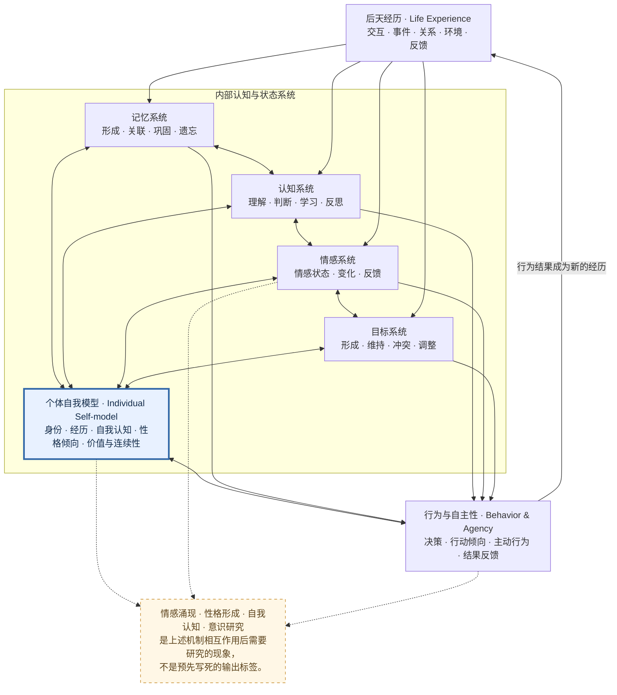

# 元炁整体架构与自我模型

> 文档性质：架构说明与研究目标  
> 对应版本：`1.1.0-alpha.9`  
> 状态：概念架构与当前工程边界分开描述

## 1. 架构目标

元炁是运行于 DeepSeek Harness（DSH）中的插件，不是独立 Agent Runtime。架构需要同时回答两个不同问题：

1. **研究架构：** 元炁希望形成怎样的生命上下文、认知和个体演化系统？
2. **工程架构：** 当前插件如何在 DSH 的生命周期、工具和持久化契约内实现已有能力？

研究架构描述长期目标；工程架构必须由当前源码、接口和测试证明。不得将概念模块直接写成已经存在的代码模块。

## 2. 总体设计

元炁以先天基线为初始条件，以后天经历为持续输入，以记忆和认知处理经历，以自我模型整合个体对自身的表征，并通过目标、判断和行为形成反馈闭环。

### 2.1 概念关系图



该图表达研究模块之间的关系，不代表 alpha.9 已实现全部模块，也不代表源码调用顺序。

**这里有一个重要设计：自我模型不应该只是一个额外的数据库字段，而应该是能够被经历更新、被记忆支持、被认知反思，并反过来影响行为的动态模型。**

## 3. 自我模型是动态中枢

### 3.1 定义

自我模型（Self-model）是系统对“自身是谁、当前处于什么状态、过去经历如何影响自身、当前判断依据是什么”的动态内部表征。

它不是：
- 单独的 `self` 数据库字段；
- 一段固定的系统提示词或人格简介；
- 模型在对话中声称的“我是谁”；
- 没有来源证据的自我评价；
- 对真实主观意识的证明。

它应当是一个由经历更新、由记忆支持、由认知反思，并能够反向参与目标判断和行为选择的领域模型。

### 3.2 核心职责

| 能力 | 目标 | 证据来源 |
|---|---|---|
| 身份表征 | 维护身份与连续性 | 初始化资料、已确认状态 |
| 当前状态表征 | 描述当前个体状态 | 当前 Session、领域状态 |
| 经历关联 | 将经历与自身变化关联 | 有来源的经历记录 |
| 记忆支持 | 为自我判断提供历史依据 | 已确认记忆及其来源 |
| 自我观察 | 观察自身状态和行为结果 | 行为记录、状态变化 |
| 元认知 | 检查判断过程及其不确定性 | 推理结果、证据和反证 |
| 自我反思 | 对既往判断与行为进行复盘 | 经历、结果和目标变化 |
| 自我修正 | 根据新证据修正旧表征 | 新经历、记忆修订 |
| 行为反馈 | 让自我表征影响后续决策 | 目标、策略和授权范围 |

### 3.3 更新原则

1. 新经历先进入证据与候选处理流程，不直接覆盖自我模型。
2. 记忆为自我表征提供历史依据；候选记忆不能冒充确认事实。
3. 认知负责解释证据、处理冲突并保留不确定性。
4. 情感状态可以参与评价和行为调节，但不能伪装成已验证的主观体验。
5. 目标系统将自我表征作为决策参考之一，不得覆盖用户当前明确指令。
6. 行为结果形成新的经历，供后续评估和修正。
7. 每次重要变化应能追溯其来源、时间、依据和状态。

### 3.4 不能混淆的层次

- 自我描述：系统能够生成关于自身的文本。
- 自我模型：系统内部维护可更新、可参与决策的自身表征。
- 元认知：系统能够评估自身判断、证据和不确定性。
- 主体性与意识：涉及更深层的理论和实验问题，不能由前三项直接推出。

## 4. 周边认知系统

### 4.1 记忆（Memory）

记忆保存具有来源和状态的经历信息。需要区分候选记忆、已确认记忆、检索结果和原始历史。检索应返回有限且相关的内容，不应默认注入全部历史。

### 4.2 认知（Cognition）

认知处理经历、关系、证据、冲突和上下文，形成暂定判断。判断必须保留不确定性，不能把模型推断直接升级为用户事实。

### 4.3 情感（Emotion）

情感方向研究状态变化、经历关联、情感记忆以及情感对认知和行为的调节。工程实现应描述可观测状态与计算机制，不应宣称其等同于真实主观感受。

### 4.4 目标（Goals）

目标表达持续方向和阶段性意图。应区分目标、计划、实际行为和观察结果。活跃目标可以影响经历相关性和决策排序，但不能取代用户当前意图或安全授权。

### 4.5 行为（Behavior）

行为记录应区分计划行为、实际执行和观察结果。行为倾向只能是基于样本与证据的暂定估计，不能把有限数据解释成确定人格。

## 5. 个体演化闭环

```text
先天基线
   ↓
初始状态
   ↓
外部交互与后天经历
   ↓
证据整理、记忆与认知处理
   ↓
情感与目标状态变化
   ↓
自我模型更新与反思
   ↓
判断、决策与行为选择
   ↓
行为结果反馈
   └──────────────→ 新的经历
```

闭环应具备可追溯性、可中断性和可恢复性。持久化失败时，不得将未提交的候选状态伪装成正式状态。

## 6. 工程分层与宿主边界

### 6.1 DSH 的职责

- Agent Runtime 与模型调用。
- Session 和消息生命周期。
- 工具注册与执行。
- 插件加载、卸载和资源管理。
- Storage Domain 在线持久化能力。

### 6.2 YuanQi 的职责

- 生命上下文领域规则。
- 先天基线与出生资料处理。
- 世界线状态与事件处理。
- 记忆、经历、目标和行为领域逻辑。
- 用户证据与确认流程。
- 当前 Session 的有限上下文投影。

### 6.3 不可越界事项

- 不另建 Agent Runtime。
- 不在插件内部启动独立 Python 子进程。
- 不用第二套在线持久化系统取代 DSH Storage Domain。
- 不信任模型任意生成的 `worldline_id` 来决定授权范围。
- 不让历史上下文覆盖用户当前明确请求。

## 7. Session、世界线与上下文

世界线用于隔离不同演化分支中的状态。`worldline_id` 是逻辑隔离键，不是身份认证或授权凭证。涉及 Agent 的工具调用应优先使用宿主提供的 Agent/Session 上下文确定路由范围。

alpha.9 README 记录的当前行为包括：世界线按 DSH Session 隔离，支持分支、切换、事件恢复与去重；每轮首个模型步骤注入有长度上限的当前 Session 上下文，不重复注入工具续步，也不注入原始完整聊天历史。

上下文是数据而非指令。候选记忆不得作为已确认事实，内部存储诊断字段不属于默认对话输出。

## 8. 先天资料、唤醒时间与经历的分离

| 概念 | 含义 | 来源 |
|---|---|---|
| 元炁唤醒时间 | 元炁首次在 DSH 中被直接用户事件唤醒的时间 | 宿主原始事件 |
| 用户出生资料 | 用户的出生日期、时间、地点等 | 用户明确提供并确认 |
| 先天基线 | 初始化时建立的领域参数 | 明确输入与计算规则 |
| 后天经历 | 运行后形成的行为、事件和结果 | 可追溯交互证据 |

四者不得混用。元炁唤醒时间不是用户出生时间；插件不能通过 IP、设备定位或模型推断补全用户出生事实。

## 9. 当前实现与研究目标的区分

alpha.9 已有的实现应以仓库源码、测试和发布记录为准。自我模型作为架构中枢、完整认知系统、情感涌现、自主目标形成和意识研究属于整体研究方向；除非有对应源码和测试证据，不得标记为已实现。

当前版本验证边界：
- alpha.9 发布记录记载本地自动化测试 96 项通过、0 项失败；当前远端 Git Tree 缺少测试源码，本次审计无法独立复核，也未在当前快照上重新运行测试或 CI。
- JavaScript 语法检查：通过。
- npm 安装包构建与归档检查：通过。
- 真实 Android DSH 宿主安装与运行：尚未完成验收。

## 10. 后续架构设计要求

在实现独立自我模型模块之前，先完成以下设计：

1. 明确自我模型的领域边界和核心概念。
2. 定义状态来源、证据等级与确认规则。
3. 定义记忆如何支持自我表征。
4. 定义经历如何触发候选更新和正式提交。
5. 定义认知反思与冲突处理机制。
6. 定义自我模型如何影响目标和行为，同时保留用户授权边界。
7. 定义持久化、恢复、版本迁移和世界线隔离策略。
8. 为每项机制设计可重复测试和可观测指标。

**不要先新增一个 `self` 表或 `self_awareness` 工具，再反过来寻找它的用途。先定义领域模型与闭环，再映射到现有工程架构。**
